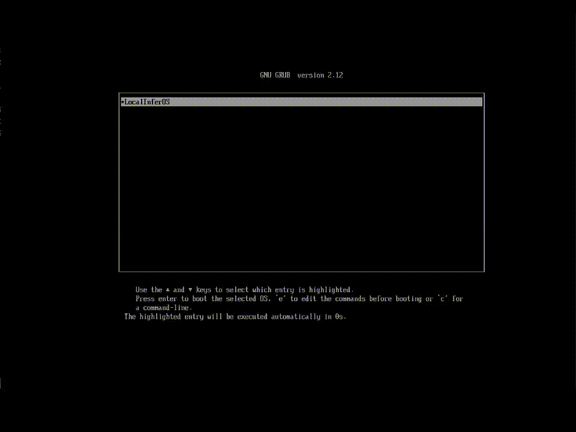
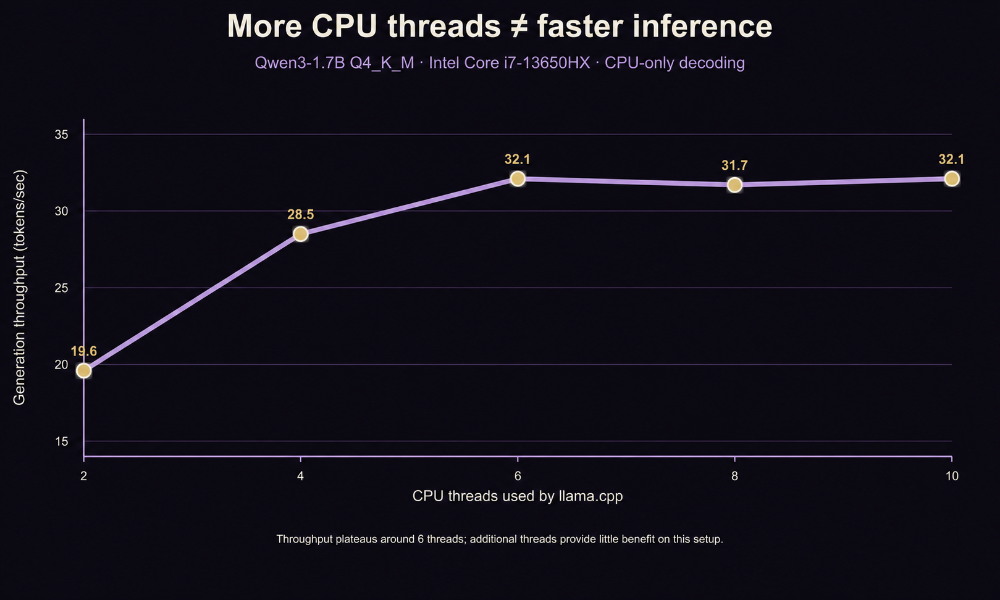
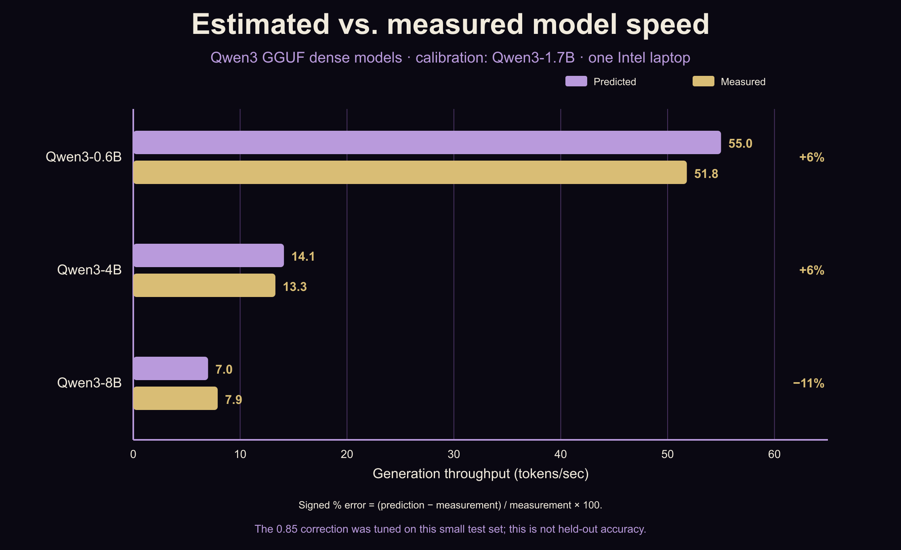
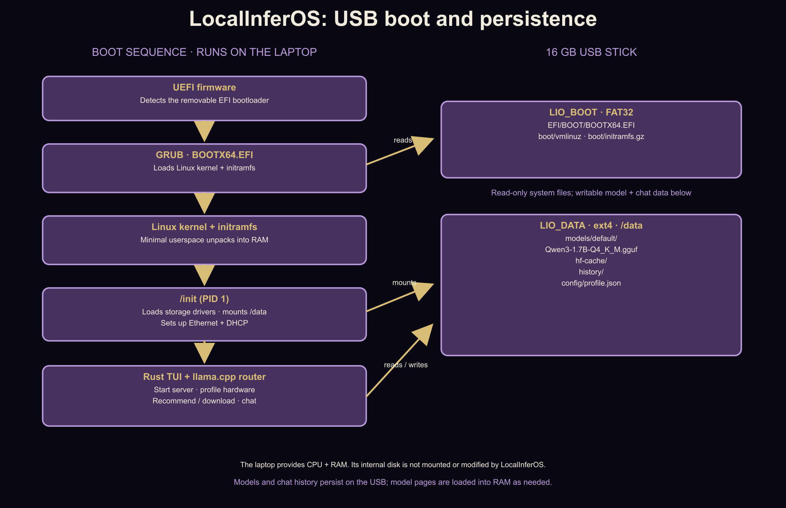

<!-- Editable source for blog/localinferos.html. Send this file back after making changes. -->

# LocalInferOS: Building an 18 MB Linux Environment for Portable LLM Inference

<nav class="blog-index" aria-label="Article index">
<h2>Index</h2>
<ol>
<li><a href="#section-01">01 — Introduction: What is LocalInferOS?</a></li>
<li><a href="#section-02">02 — Predicting LLM Performance Without Downloading Every Model</a></li>
<li><a href="#section-03">03 — Building a Linux OS That Does Almost Nothing</a></li>
<li><a href="#section-04">04 — Three Things That Broke Along the Way</a></li>
<li><a href="#section-05">05 — Limitations and What's Next</a></li>
</ol>
</nav>

<a id="section-01"></a>
## 01 — Introduction: What is LocalInferOS?

Have you ever wished you could run a local LLM that makes the most of your laptop or desktop's available CPU and RAM? Well, wish no more, for I have the answer to a question you probably never asked.

Introducing **LocalInferOS**: a minimal BusyBox-based Linux system that uses Ubuntu's kernel, llama.cpp for inference, and a Rust TUI that boots directly into a local LLM chat interface. The entire compressed initramfs is just **18 MB** (43 MB unpacked), including the required kernel module tree. The Linux kernel and model weights are separate, before anyone asks.

The way it works is fairly simple. You download the `.img.xz` file from the GitHub releases, decompress it, flash the image onto your USB stick, plug it into your machine, and boot straight into LocalInferOS. Instructions for building the image yourself are also provided in the README, for those who are a little extra paranoid about the man upstairs stealing their data to train AI models that'll eventually replace them. Jkjk (mostly).

Once you're in, LocalInferOS profiles your hardware, benchmarks the bundled Qwen3-1.7B model, and uses the results to estimate how fast other local LLMs would run on your machine. It then recommends models based on your machine's RAM and estimated token generation speed. You can download another model over Ethernet or stick with the bundled Qwen3-1.7B and start chatting. The interesting part is that **the models, conversation history, and configuration all live on the USB stick itself**. No installation on the laptop's internal SSD is needed.

But how does all of this actually work?


*The finished TUI keeps the hardware profile, model estimates, and local chat in the same terminal interface.*

This is what the finished system looks like in practice. The top of the TUI shows the detected CPU and RAM, selected llama.cpp thread count, calibrated reference throughput, estimated bandwidth, and model recommendations. The chat remains directly below it, so the profiling logic stays visible without turning the entire system into a benchmarking dashboard.

<figure class="blog-figure blog-demo">

<figcaption>A working LocalInferOS demo showing the system in use.</figcaption>
</figure>

---

<a id="section-02"></a>
## 02 — Predicting LLM Performance Without Downloading Every Model

This was probably the most interesting part of the project. Before somebody downloads a multi-gigabyte GGUF model, I wanted LocalInferOS to answer two questions:

- Will this model fit in memory?
- How many tokens per second can I realistically expect?

The obvious solution would be to download every candidate model, benchmark it, and recommend whichever performed best. Unfortunately, downloading 30 GB of models to figure out which one works on a 16 GB USB stick seems like a slight design flaw. So instead, I wanted to **benchmark a single reference model and use its performance to predict the others**.

### Why this works: LLM generation is often memory-bandwidth-bound

LLMs generate text autoregressively, meaning they predict one token at a time. For a typical dense transformer running single-user inference, generating a token involves matrix-vector operations that access most of the model's weights. These operations perform relatively little arithmetic per byte of weight data. Modern CPUs can execute enormous numbers of arithmetic operations per second, but accessing data from RAM is comparatively expensive.

Consequently, **single-stream CPU token generation is often limited by memory bandwidth rather than raw computational throughput**.

This gives us a simple approximation:

\[
\text{Tokens/sec} \approx
\frac{\text{Effective memory bandwidth}}
{\text{Weight bytes accessed per token}}
\]

For a dense model, the weight bytes accessed per token are approximately the model's quantized weight size.

For example, if a machine achieves 40 GB/s of effective inference bandwidth, a 5 GB model would theoretically generate around:

\[
\frac{40}{5}=8\text{ tokens/sec}
\]

Double the model size, and generation throughput should roughly halve.

Of course, this is an approximation. Attention, KV-cache reads, quantization overhead, synchronization, and kernel efficiency all complicate the picture. But it's a useful starting point.

One important distinction: this model estimates **generation speed**, or the rate at which new tokens appear. Prompt processing is a different workload, where processing multiple tokens together allows greater weight reuse and is often much more compute-intensive. LocalInferOS currently predicts generation throughput, not prompt-processing throughput.

### Benchmarking the Reference Model

For the reference model, I use **Qwen3-1.7B Q4_K_M**, whose GGUF is approximately 1.28 GB. I used llama.cpp's `llama-bench` tool for benchmarking and a simplified benchmark command looks like this:

```bash
llama-bench -m Qwen3-1.7B-Q4_K_M.gguf -ngl 0 -p 0 -n 64 -r 1 -o json
```

The important arguments are:

- `-ngl 0`: CPU-only inference.
- `-p 0`: Skip the separate prompt-processing benchmark.
- `-n 64`: Benchmark generating 64 tokens.
- `-r 1`: Run each configuration once initially to keep profiling fast.
- `-o json`: Return machine-readable output that Rust can parse.

However, measuring one thread configuration wouldn't tell us much.

### Finding the optimal CPU thread count

More CPU threads should mean more performance, right? Well, not necessarily. Initially, adding threads increases inference throughput because more CPU cores can participate in reading weights and performing computations. Eventually, though, memory bandwidth becomes saturated. Beyond that point, additional threads contribute little and can sometimes slow things down through contention and synchronization overhead.

Here's what I measured on my Intel Core i7-13650HX:

| CPU threads | Generation speed |
|---|---:|
| 2 | 19.6 tok/s |
| 4 | 28.5 tok/s |
| 6 | 32.1 tok/s |
| 8 | 31.7 tok/s |
| 10 | 32.1 tok/s |



*Figure 1: CPU thread count versus generation throughput.*

Performance improves significantly between two and six threads, then more or less plateaus. My processor exposes 20 logical threads, but using all of them isn't necessary to achieve near-maximum performance for this workload. LocalInferOS therefore tests a series of thread counts rather than assuming that the maximum available count is optimal. The profiler starts with a small number of threads, increases the count, and stops after observing a slowdown. On my machine, that means it can stop after testing 2, 4, 6, and 8 threads. This is a heuristic rather than an exhaustive optimization. A noisy measurement could cause an early stop, and a later thread count might perform similarly or better.

Still, it reduces profiling time substantially, with typical runs on my setup taking roughly 10–20 seconds. The chosen `best_threads` value is saved and passed to llama.cpp during normal chat inference.

### Why I don't trust a single benchmark run

While testing, I noticed something strange. A 4B model that normally generated around 14 tok/s would occasionally report over 40 tok/s. That result would imply effective memory bandwidth greater than I would expect from the laptop's memory configuration. Other runs occasionally reported 0.0 tok/s, even though the benchmark had finished within seconds. These anomalies appeared during testing under WSL. Timing or clock behavior is a possible explanation, although I haven't isolated the exact cause. To avoid building the entire predictor around an obviously incorrect measurement, I added a validation step.

After finding the best thread count, LocalInferOS benchmarks that configuration again.

- If the two measurements agree within 20%, it uses their average.
- If they disagree, it takes a third measurement and uses the median.

This provides protection against measurement outliers without requiring repeated benchmarking of every thread configuration.

### Estimating Effective Memory Bandwidth

Once I have a stable generation throughput measurement, I can estimate the effective memory bandwidth achieved by the inference workload.

The formula is:

\[
BW_{\text{effective}} =
TPS_{\text{measured}}\times W_{\text{reference}}
\]

On my laptop, the calibrated generation speed was approximately 32.4 tok/s. Using the 1.28 GB reference model:

\[
BW_{\text{effective}}
=32.4\times1.28
\approx41.5\text{ GB/s}
\]

This isn't a direct measurement of physical RAM bandwidth. It's an **inference-derived effective bandwidth**, capturing how efficiently this particular combination of CPU, quantization, llama.cpp implementation, and thread configuration processes the reference model. That's arguably more useful than the memory bandwidth advertised on a hardware specification sheet, because it's closer to the actual workload I want to predict.

### Predicting other models

The prediction formula is:

\[
TPS_{\text{estimated}} =
0.85\times
\frac{BW_{\text{effective}}}{W_{\text{candidate}}}
\]

The additional **0.85 factor** is an empirical correction.

When I tried the raw bandwidth formula, it was overly optimistic for some other model sizes. Multiplying by 0.85 improved the predictions on my test machine while keeping them reasonably conservative.

Here's how it performed against actual measurements:

| Model | Predicted | Measured | Error |
|---|---:|---:|---:|
| Qwen3-0.6B | 55.0 tok/s | 51.8 tok/s | +6% |
| Qwen3-4B | 14.1 tok/s | 13.3 tok/s | +6% |
| Qwen3-8B | 7.0 tok/s | 7.9 tok/s | −11% |



*Figure 2: Predicted versus measured generation throughput for three Qwen3 models.*

The signed error is calculated as:

\[
\text{Error} =
\frac{TPS_{\text{predicted}}-TPS_{\text{measured}}}
{TPS_{\text{measured}}}\times100\%
\]

The predictions were within approximately **11–12% of measured throughput** for these three models. Considering that I'm using a single reference model and a relatively simple formula, I was pretty happy with that. However, there are some important caveats.

First, the correction factor was calibrated on this particular Intel CPU. There's no guarantee that it will perform equally well on an AMD processor, an older laptop, or a workstation with a different memory architecture.

Second, the same small set of models helped motivate the correction factor and evaluate it. This is a calibration result, not an independent held-out evaluation.

A proper assessment would require testing additional architectures, quantization formats, and CPUs using separate calibration and validation data.

### Why the predictions aren't perfect

Not all inference time is spent reading model weights. There's also attention computation, KV-cache access, per-layer overhead, thread synchronization, and quantization-kernel behavior. For smaller models, fixed costs account for a larger fraction of total execution time, making simple weight-size extrapolation less accurate. As conversations become longer, the growing KV cache can also reduce generation throughput. The predictor also isn't suitable for mixture-of-experts models without modification. An MoE model may store tens of billions of parameters but activate only a fraction of them during each token's computation. Consequently, its total GGUF size isn't a good approximation of the weights accessed per token.

For now, LocalInferOS uses this estimator for supported dense models.

### Will the Model Actually Fit in RAM?

Predicting 30 tokens/sec is rather pointless if the machine doesn't have enough memory to load the model.

The GGUF file size gives us a starting point, but inference requires additional memory for the KV cache, working buffers, the kernel, llama.cpp, and the Rust interface.

LocalInferOS uses an initial approximation:

\[
RAM_{\text{required}}
\approx1.2\times\text{Model size}+1\text{ GiB}
\]

The additional 20% provides an approximate allowance for model-related runtime overhead, including the KV cache for a modest context length around 4096 tokens. The extra 1 GiB reserves space for the operating system and other runtime allocations. This isn't an exact upper bound. KV-cache memory varies significantly with model architecture, context length, and cache data type. One design choice is that **the predictor compares this estimate against total RAM, not currently available RAM**. Because LocalInferOS is such a minimal environment, there's usually very little else consuming memory. Total physical RAM therefore provides a useful first approximation. Models that exceed the estimated memory limit are flagged as potentially unsuitable. The user can still force the download if they want to experiment, but the model may load slowly, perform poorly, or fail.

The recommendation table primarily uses two signals:

1. Estimated generation throughput.
2. Estimated RAM requirements.

USB storage availability is checked separately when the user actually runs `/download`.

The selected thread count and calibrated throughput are saved to `/data/config/profile.json`, so subsequent boots don't need to repeat the benchmark. Since the USB is portable, LocalInferOS reprofiles whenever it encounters a different machine.

---

<a id="section-03"></a>
## 03 — Building a Linux OS That Does Almost Nothing

Now for the operating-system side of things. I didn't write a Linux kernel from scratch. Instead, I took an Ubuntu-packaged Linux kernel and built a minimal userspace around it.

The major components are:

| Component | Purpose |
|---|---|
| Ubuntu Linux kernel | Hardware, memory and process management |
| BusyBox | Minimal shell and Unix utilities |
| GRUB | UEFI bootloader |
| initramfs | Initial RAM-backed filesystem |
| llama.cpp | GGUF inference and model management |
| Rust + Ratatui | Terminal user interface |
| ext4 | Persistent data storage |

No desktop environment, no systemd, no package manager, and no unnecessary background services. The compressed initramfs is approximately **18 MB**, expanding to about **43 MB in RAM**. That already includes the required kernel module tree. The kernel and bundled GGUF model are separate from that 18 MB figure.


*LocalInferOS after reaching the custom userspace, before the Rust TUI takes over.*

The boot screen is intentionally uneventful. Once the kernel reaches the custom userspace, `/init` loads the required drivers, mounts the persistent data partition, configures networking, and starts the application. Keeping that process visible also made failures much easier to diagnose than they would have been behind a splash screen.

### How the USB actually boots

The USB contains two partitions.

**Partition 1: `LIO_BOOT` (FAT32)**

Contains the UEFI bootloader, Linux kernel, and initramfs.

**Partition 2: `LIO_DATA` (ext4)**

Contains the bundled default GGUF, downloaded model cache, conversation history, and configuration files.

The overall boot sequence is shown below:



*Figure 3: USB partition architecture and boot sequence.*

UEFI loads GRUB, which starts the kernel and initramfs. The BusyBox `/init` script loads the required drivers, mounts persistent storage, and configures Ethernet before launching the Rust TUI. The OS runs primarily in RAM while models and conversation history remain on the USB.

### Why FAT32 and ext4?

FAT32 is used for the UEFI boot partition because it's the conventional filesystem supported by UEFI firmware. The data partition uses ext4 because it's a native Linux filesystem and supports files larger than FAT32's 4 GiB per-file limit.

### What actually lives on the USB?

The persistent data partition has the following structure:

```text
/data/
├── models/
│   └── default/
│       └── Qwen3-1.7B-Q4_K_M.gguf
├── hf-cache/
├── history/
└── config/
    └── profile.json
```

Each directory has a distinct role.

**`models/default/`** contains the pre-bundled Qwen3-1.7B reference model. This model is available without an internet connection and is also used for initial hardware profiling.

**`hf-cache/`** is where llama.cpp's model-management functionality maintains downloaded model files and related cache data. Instead of manually managing every download, LocalInferOS delegates this work to llama.cpp's router.

**`history/`** stores persistent conversation history. This is what allows the user to boot LocalInferOS on another machine and retain previous conversations.

**`config/profile.json`** stores the hardware profiling results, including the selected CPU thread count and calibrated inference performance.

The entire data partition resides on the USB stick. Nothing needs to be installed or written to the laptop's internal drive. Naturally, switching hardware means the inference performance may change, which is exactly why the profiling system exists in the first place.

### Kernel modules without a full distribution

A major difficulty with such a minimal Linux environment is that normal Linux distributions handle a lot of hardware compatibility automatically. Strip away most of the distribution, and suddenly you have to think about things like SATA drivers, USB controllers, filesystem drivers, and network adapters yourself. Initially, I was loading individual `.ko` files manually in a particular order. That quickly became inconvenient because kernel modules often depend on other modules.

The current solution uses the standard Linux module infrastructure:

- At build time, `depmod` generates the dependency information.
- At boot, `/init` uses `modprobe` to load the necessary drivers and their dependencies.

This keeps the init script smaller and makes it easier to add support for more hardware. It doesn't magically provide every possible driver, though. Required kernel modules and firmware still need to be included in the image. Wi-Fi is a particularly interesting challenge here. Different laptop chipsets require different drivers and firmware, so Ethernet is currently the simpler supported route for downloading models.

### Why Rust for the interface?

I used Rust and Ratatui for the terminal interface, process management, benchmark parsing, and download monitoring. llama.cpp still handles the actual inference, so Rust isn't magically making matrix multiplication faster. Fortunately, it does earn me those sweet Rustacean brownie points.

---

<a id="section-04"></a>
## 04 — Three Things That Broke Along the Way

Building a tiny Linux environment sounds simple until something breaks and you realize you've removed most of the tools you'd normally use to debug it.

A few problems were particularly interesting.

### Bug #1: The Download That Silently Stopped

Rather than implementing an entire Hugging Face downloader myself, LocalInferOS uses llama.cpp's server in router mode. The server already handles model downloads, caching, resuming incomplete downloads, and loading models afterward. My Rust TUI just needs to request a model and display progress. Simple enough, right?

During testing under WSL, I tried downloading Qwen3-0.6B, a roughly 640 MB model. The download progressed normally until it reached **263 MB**. Then it stopped. Just 0 KB/s forever, while the server continued reporting that it was downloading.

At the same time, `curl` could download the exact same file from Hugging Face at around 20 MB/s, so the network connection wasn't the problem. The llama.cpp download process had stalled.

#### Finding the fix

Restarting llama-server revealed that it recognized the model as incomplete. Requesting the same model again resumed the download from around 263 MB rather than starting over. That was useful, but forcing users to restart the inference server every time a download stalled wasn't exactly the seamless experience I had in mind. After looking through llama.cpp's source, I found a better option.

Sending a request to:

```text
POST /models/unload
```

could cancel the ongoing download in place.

Requesting the model again would then resume the incomplete download, without restarting the server. So I added a download watchdog. The Rust TUI listens to the server's download event stream and monitors the reported number of downloaded bytes. If that number doesn't increase for 30 seconds, the watchdog:

1. Cancels the download.
2. Requests the model again.
3. Repeats if necessary, up to five retries.

However, there was one problem. Cancelling the download causes the server to emit a `download failed` event. Without additional handling, the TUI would interpret its own intentional cancellation as an unexpected failure. So the watchdog tracks the cancellations it initiated and ignores the corresponding failure reports. A fairly small change, but it made downloads substantially more resilient to silent stalls.

#### The bug inside the bug

While investigating the stalled download, I found another issue. My HTTP client had a 30-second total request timeout. That might sound reasonable for an API call, but LLM inference isn't a typical short-lived API request. A generated response can legitimately take more than 30 seconds. With that timeout applied globally, a perfectly healthy long response could get terminated simply because the model hadn't finished generating. So the download stall needed its own **inactivity watchdog**, rather than a blanket 30-second timeout on every HTTP request.

One more design constraint emerged: because the router was configured to keep only one model loaded at a time, loading a chat model could interfere with an active download. For now, LocalInferOS pauses chatting while a model is downloading. Not ideal, but significantly better than having downloads disappear halfway through a conversation.

### Bug #2: "You Need to Load the Kernel First"

The first USB image reached GRUB and immediately stopped with:

```text
error: you need to load the kernel first
```

I spent longer than I care to admit checking file paths, partition labels, and whether `/boot/vmlinuz` actually existed. It did. Opening the GRUB command line made the real problem obvious: `ls` showed `(hd0)`, but not `(hd0,gpt1)` or `(hd0,gpt2)`. GRUB could see the USB device, but the standalone build couldn't interpret its GPT partitions or read the FAT boot filesystem.

Adding `insmod part_gpt` and `insmod fat` fixed the boot. The visible kernel error was only a downstream symptom; GRUB never had access to the partition containing the kernel in the first place. The useful lesson was fairly simple: before debugging the file you expect a system to load, ask what the system can actually see.

### Design Problem #3: How Do You Shut Down an OS Whose Init Is a Shell Script?

This is probably my favorite small design decision. In LocalInferOS, `/init` is a shell script running as **PID 1**. PID 1 is special in Linux. It's the first userspace process started by the kernel, and the system expects it to remain alive. If PID 1 exits unexpectedly, Linux can panic. My init script therefore runs the Rust TUI in a loop, restarting it when the application exits normally. But I still needed a way for the user to shut down the entire computer. I didn't want the Rust TUI to directly handle low-level shutdown operations, especially because the same application also runs during development on my regular machine.

Accidentally shutting down my development laptop while testing a keyboard shortcut would be a rather unfortunate feature. So I used an extremely simple interface: **process exit codes**.

When the user presses `Ctrl+Q`:

1. The TUI stops llama-server and its model processes.
2. It exits with the special status code `10`.
3. `/init` recognizes the code as a shutdown request.
4. It allows model processes time to finish.
5. It runs `sync` to flush pending writes to the USB.
6. It unmounts `/data` cleanly, or switches to a read-only state if something still holds it open.
7. Finally, it invokes `poweroff -f`.

If the TUI exits normally with code `0`, such as through `Ctrl+C`, `/init` restarts it instead.
Conceptually, the contract looks like this:

```text
Rust TUI exits
       |
       v
/init checks exit code
       |
       +-- 0  -> Restart TUI
       |
       +-- 10 -> Flush data
                 Unmount /data
                 Power off
```

The neat part is that **the Rust application doesn't need to know whether it's running as part of a bootable operating system**. It simply exits with a status code. On a regular development machine, there is no LocalInferOS `/init` supervising it, so `Ctrl+Q` just exits the application. On the USB-booted OS, PID 1 interprets the exact same action as a shutdown request. No systemd, no D-Bus, no custom IPC protocol.

---

<a id="section-05"></a>
## 05 — Limitations and What's Next

As much as I'd like to claim that LocalInferOS is the future of computing, there are a few things it doesn't do yet.

**CPU-only inference.** GPU acceleration would be extremely useful, but supporting NVIDIA, AMD, and Intel GPUs across different laptops introduces substantial driver and backend complexity.

**Limited Wi-Fi support.** Ethernet works with supported hardware, but broad Wi-Fi compatibility requires additional chipset drivers, firmware, and authentication support.

**UEFI x86-64 only.** The current USB design targets x86-64 machines using UEFI. The unsigned bootloader also requires Secure Boot to be disabled on systems that enforce it.

**Approximate throughput predictions.** The predictor assumes dense, memory-bandwidth-dominated inference. Its correction factor was calibrated on one CPU, and the validation set is small.

**Prompt processing isn't predicted.** For longer inputs, prefill latency can be a substantial part of the total response time.

**Thermal throttling.** A short benchmark on a cool laptop may not reflect performance after several minutes of sustained inference.

If I was to spend more time developing this here are some of the things I'd like to explore next:

- A more accurate throughput predictor using GGML operator-level benchmarking.
- GPU acceleration and mixed CPU/GPU offloading.
- Broader Wi-Fi and hardware compatibility.
- Better performance prediction across different CPU architectures.
- More accurate RAM requirements based on each model's KV-cache configuration.
- A larger evaluation of predicted versus measured inference speed.

In particular, I think the performance predictor has the most room for technically interesting improvements. The current approximation is useful, but it would be fascinating to see whether benchmarking a small set of quantized kernels could predict the throughput of unseen models more accurately across different hardware.

### Final thoughts

LocalInferOS started with a fairly simple question: **how much of a Linux environment can you strip away before you're left with just enough to run a local LLM?** It turns out, quite a lot.

The 18 MB initramfs is satisfying, but the more interesting part was making inference adapt to whatever hardware happens to boot the USB. The predictor is still approximate and the supported hardware is deliberately narrow, but the initial results are encouraging.

And there is something fun about carrying an entire local AI environment on a USB stick, plugging it into a compatible machine, and chatting without installing anything on the internal drive. Is this the future of computing? Obviously. An entirely unbiased opinion from someone who spent far too much time building it.

**GitHub:** [github.com/adixg/localinferos](https://github.com/adixg/localinferos)

**Release and build instructions:** [GitHub releases and README](https://github.com/adixg/localinferos#readme)
