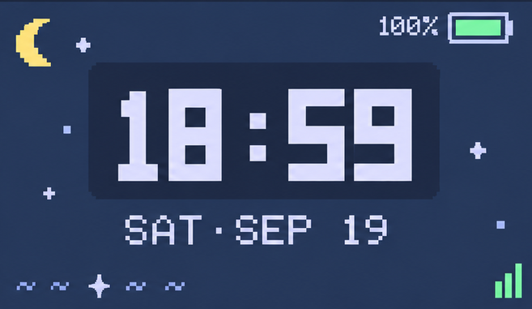
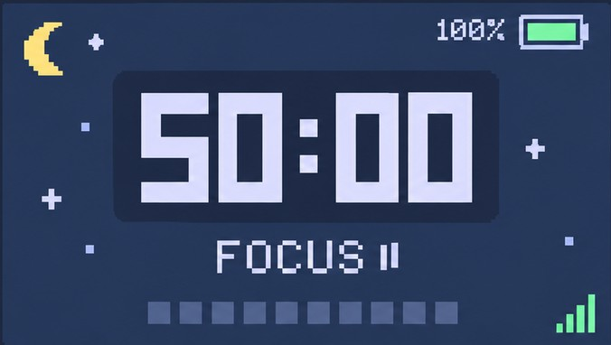
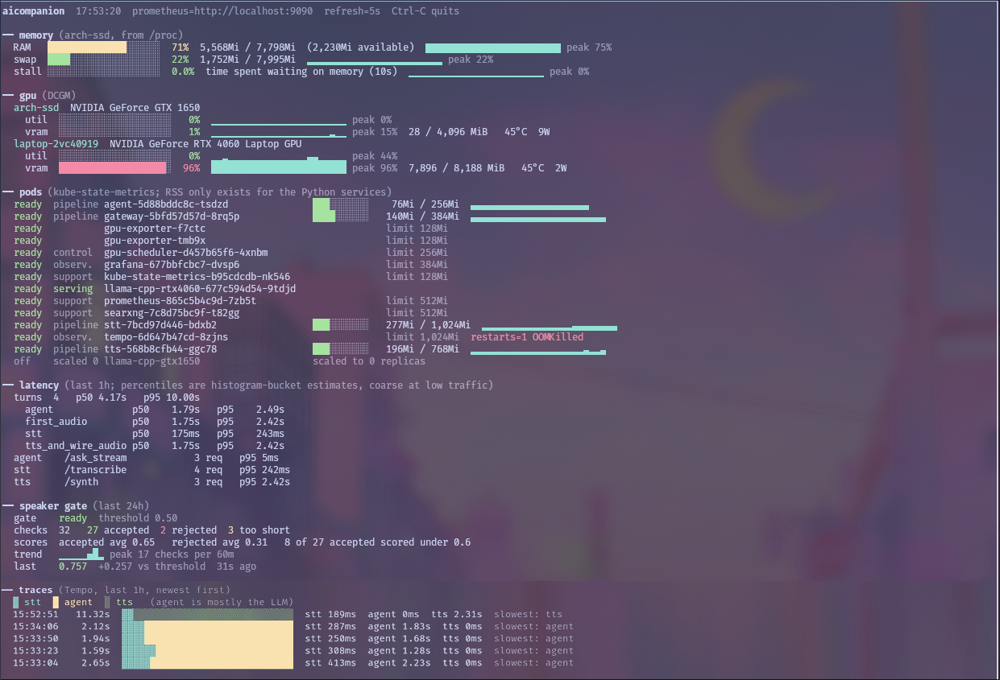
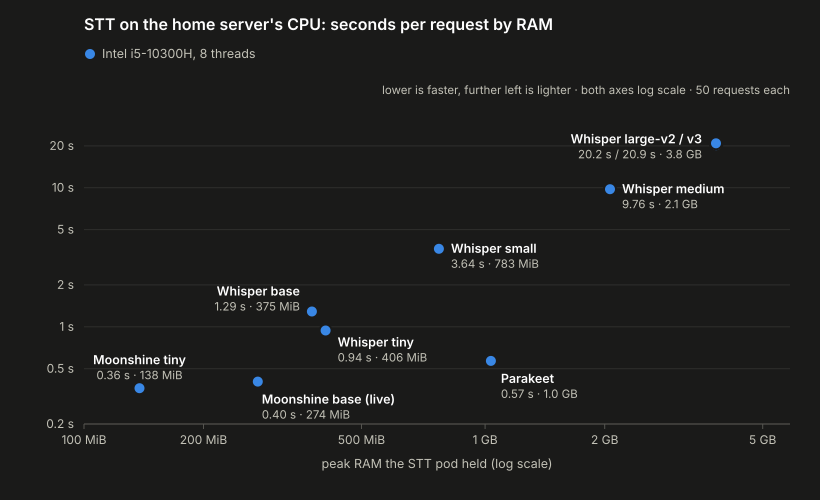
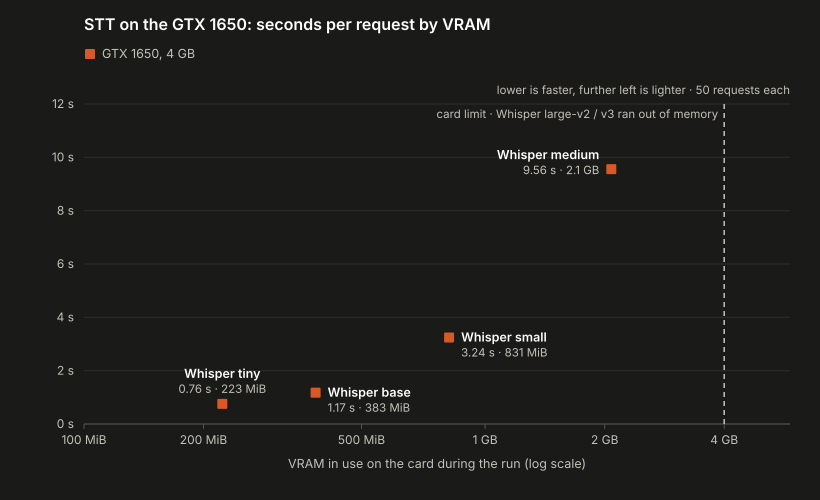
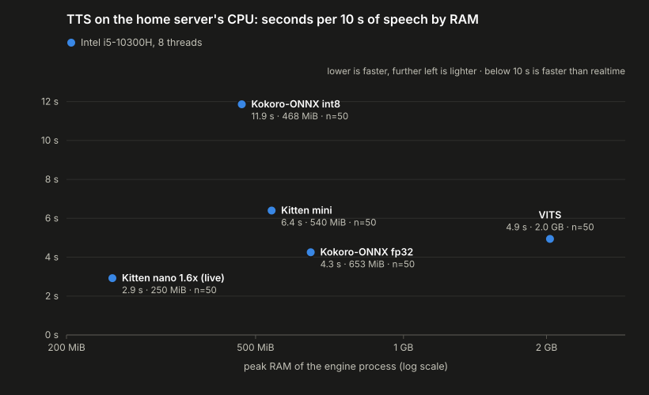
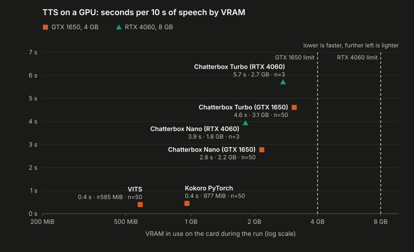

<!-- Editable source for blog/voice-assistant.html. Send this file back after making changes. -->

# Building My Own Inference Infrastructure: Kubernetes, GPU Failover, and Benchmarking

*Part 1 — Building a Self-Hosted AI Voice Assistant*

<nav class="blog-index" aria-label="Article index">
<h2>Index</h2>
<ol>
<li><a href="#section-01">01 — The Architecture</a></li>
<li><a href="#section-02">02 — Building a Custom Kubernetes Controller</a></li>
<li><a href="#section-03">03 — Distributed Tracing and Observability</a></li>
<li><a href="#section-04">04 — Benchmarking Speech-to-Text Models</a></li>
<li><a href="#section-05">05 — Benchmarking Text-to-Speech Models</a></li>
<li><a href="#section-06">06 — What I've Learned and What's Next</a></li>
</ol>
</nav>

Turns out my RTX 4060 and GTX 1650 aren't exactly an NVIDIA data center, but that hasn't stopped me from treating them like one.

Over the past few months, I've been building my own voice assistant using a tiny ESP32-S3, my personal laptop, and an old laptop that I use as a home server.

The original idea was pretty simple: I wanted to build something similar to a Google Home or Alexa, except with locally hosted models and the ability to customize practically everything.

Somehow, this turned into a Kubernetes cluster, a custom GPU failover controller, an entire observability stack, and a LOT of benchmarking. A perfectly reasonable amount of infrastructure for something I could have just opened ChatGPT for.

This is Part 1 of a two-part series about the project. Here, I'll focus on how I distributed the inference workloads across my hardware, built the Kubernetes controller, and used benchmarking and distributed tracing to make the system more responsive.

In Part 2, I'll get into the actual voice assistant: how the ESP32 communicates with my laptops, the voice interaction pipeline, and how I gave it access to the internet and other tools.

<figure class="blog-figure"><figcaption>Assistant</figcaption></figure>
<figure class="blog-figure"><figcaption>Clock</figcaption></figure>
<figure class="blog-figure"><figcaption>Pomodoro</figcaption></figure>

## 01 — The Architecture

The assistant itself runs on an M5StickS3, a tiny ESP32-S3 device with a microphone, speaker, and display.

I implemented an on-device wake-word detector using microWakeWord, so saying "Assistant" activates it without needing to press any buttons. Once it detects that I've finished speaking, it sends the audio over Bluetooth Low Energy (BLE) to my Android phone, which acts as a relay to the backend.

The backend runs on a lightweight Kubernetes distribution called **k3s**, with three main components:

1. **Speech-to-text (STT):** Moonshine converts my speech into text.
2. **LLM inference:** Qwen processes the request using llama.cpp.
3. **Text-to-speech (TTS):** KittenTTS converts the response back into audio.

The STT, agent, and TTS services run on my always-on home server. The LLM backend depends on which GPU is available.

| Hardware | GPU | Model | Role |
|---|---|---|---|
| Personal laptop | RTX 4060 | Qwen3-8B | Preferred LLM backend |
| Home server | GTX 1650 | Qwen3.5-4B | Fallback LLM backend |

<pre class="architecture" aria-label="Overall voice assistant architecture">M5StickS3
wake word · microphone · speaker
        │ BLE
        ▼
Android relay
BLE central · WebSocket client
        │ WebSocket over Tailscale
        ▼
k3s gateway
   ├── Moonshine STT ── CPU
   ├── Agent + MCP tools
   │      ├── Qwen3-8B ───── RTX 4060 (preferred)
   │      └── Qwen3.5-4B ─── GTX 1650 (fallback)
   └── KittenTTS ─────── CPU</pre>

The main constraint here is that my personal laptop isn't always available. Sometimes I'm using it elsewhere, sometimes it's switched off, and sometimes it simply disconnects from the cluster.

I didn't want my voice assistant to stop working every time that happened.

I also didn't want to keep the fallback model loaded on my home server unnecessarily, since that machine only has a GTX 1650 with 4 GB of VRAM.

This was what led me to build my own Kubernetes controller.

## 02 — Building a Custom Kubernetes Controller

Kubernetes already handles things like scheduling pods, restarting failed containers, and maintaining deployment state.

However, my problem was slightly different.

I needed the assistant to prefer the more powerful RTX 4060 when my laptop was available, automatically switch to the GTX 1650 when it wasn't, and reclaim resources on my home server when the RTX 4060 came back online.

So I wrote a custom controller called `gpu-scheduler`.

### How it works

The controller follows Kubernetes' reconciliation pattern. Instead of reacting to an event and assuming everything worked, it repeatedly checks the current state of the cluster and tries to bring it in line with the desired configuration.

In my implementation, it reconciles every 10 seconds and also reacts to events involving the RTX 4060 node.

There are two main scenarios.

**Scenario 1: My laptop is online**

The controller checks whether the RTX 4060 node is `Ready` and whether its llama.cpp inference server is actually available.

If both conditions are satisfied, it configures the agent to use Qwen3-8B on the RTX 4060.

Once the agent rollout has completed and the RTX 4060 has remained available for 60 seconds, the controller scales the GTX 1650 standby deployment down to zero.

This frees approximately **1 GiB of RAM and 3.4 GiB of VRAM** on the home server.

The 60-second stability window is important because I don't want a laptop that briefly disconnects and reconnects to cause unnecessary model reloads.

**Scenario 2: My laptop goes offline**

If the RTX 4060 node becomes unavailable or its inference server stops responding, the controller scales the GTX 1650 deployment back up.

However, starting a pod doesn't necessarily mean the model is ready for inference.

The controller waits until the fallback backend reports that it is ready before updating the agent's inference endpoint to Qwen3.5-4B.

<pre class="architecture" aria-label="Kubernetes GPU controller reconciliation flow">Every 10 seconds or on an RTX 4060 node event
                         │
                         ▼
         Is the node Ready and llama.cpp available?
                    ┌────┴────┐
                   yes        no
                    │          │
          point agent to       scale GTX 1650 up
          Qwen3-8B             and wait for readiness
                    │          │
          stable for 60 s?     point agent to
                    │          Qwen3.5-4B
                    ▼
          scale standby to zero</pre>

### The tradeoff: cold versus warm standby

Here's where things get interesting.

Starting the fallback deployment from zero requires loading the model into memory, initializing the inference server, and waiting for readiness.

I measured approximately **61 seconds for the cold fallback to become ready**, excluding the additional time Kubernetes may take to detect that the laptop has disappeared.

That's obviously not ideal if I'm in the middle of a conversation.

An alternative is to keep the GTX 1650 model running in the background. That makes failover much faster, but permanently occupies RAM and VRAM on my already resource-constrained home server.

I ended up supporting both modes:

- **Cold standby:** Saves memory when the RTX 4060 is available, at the cost of slower failover.
- **Warm standby:** Keeps the fallback model loaded for faster recovery, at the cost of additional resource consumption.

There is also a limitation worth mentioning: switching inference backends patches the agent's Kubernetes Deployment, which triggers a pod rollout. Requests already in flight can fail, and requests during cold failover may need to be retried.

So this isn't zero-downtime failover, at least not yet.

Also, technically speaking, this isn't a per-request GPU scheduler. It is an availability-aware inference controller. It doesn't dynamically allocate individual requests based on GPU utilization or queue length.

That's something I'd like to explore later.

### Why not just use a Python script?

To be fair, for two machines, a Python script that checks whether my laptop is online and switches an endpoint would probably have worked.

But I wanted something that could recover from failed operations and changes in cluster state without depending on a sequence of commands executing successfully.

The reconciliation approach handles this more naturally: observe the current state, determine what needs to change, apply the change, and repeat.

It also made the project a useful introduction to writing custom Kubernetes controllers instead of just deploying applications onto a cluster.

## 03 — Distributed Tracing and Observability

Once I had the infrastructure running, the next problem was figuring out why some interactions felt noticeably slower than others.

A voice assistant has several stages, and each can introduce latency:

- Capturing and transferring audio
- Speech recognition
- LLM processing and token generation
- Speech synthesis
- Returning audio to the device

Even if each model performs reasonably well individually, the total response time can still be frustrating.

Simply measuring the time between sending a request and receiving a response doesn't tell me which stage is responsible.

So I set up an observability stack using **Prometheus, Grafana, OpenTelemetry, and Tempo**.

Prometheus scrapes metrics from the services every 15 seconds, while Grafana provides dashboards for request latency, error rates, pod health, and hardware utilization.

OpenTelemetry and Tempo let me trace requests across the STT, agent, and TTS services.

This means I can inspect how much time each stage takes rather than guessing where the bottleneck might be.

<figure class="blog-figure">

<figcaption>Figure 1: The terminal dashboard shows host memory, both GPUs, pod health, end-to-end latency, and recent turns split into STT, LLM, and TTS.</figcaption>
</figure>

### Writing my own GPU exporter

I also wanted GPU-level visibility.

In particular, I needed to understand how much VRAM and GPU compute each inference configuration was consuming, especially on the GTX 1650.

I initially used NVIDIA's DCGM Exporter, but found its memory footprint unnecessarily large for my setup.

So I wrote my own lightweight GPU metrics exporter using NVIDIA's Management Library (NVML).

The result was a reduction in the monitoring component's measured memory footprint from approximately **405 MiB to 37 MiB**, or about **91%**.

Along with GPU utilization and memory usage, I added metrics for GPU clocks, throttling reasons, energy consumption, XID errors, and VRAM usage per pod.

I appreciate the irony of spending time optimizing the monitoring system because it was consuming too many resources on the system it was supposed to monitor.

But on a machine with limited resources, those savings actually matter.

It also gives me more useful information when investigating performance: I can examine GPU memory pressure and utilization alongside the inference service's latency.

I built a small terminal dashboard as well, since apparently Grafana wasn't enough. It shows host memory, GPU usage, pod status, latency, and recent turns without having to open a browser.

## 04 — Benchmarking Speech-to-Text Models

With the infrastructure in place, the next question was which models I should actually run.

The goal wasn't necessarily to use the best-performing speech model on a benchmark leaderboard. I needed something that would run quickly, consume relatively little memory, and still provide usable transcription quality.

I benchmarked multiple STT models on my available hardware, comparing their inference latency and memory requirements.

<figure class="blog-figure"><figcaption>Figure 2a: CPU speech-to-text latency versus peak RAM.</figcaption></figure>
<figure class="blog-figure"><figcaption>Figure 2b: GPU speech-to-text latency versus VRAM.</figcaption></figure>

One thing that became apparent pretty quickly was that larger models weren't automatically worth the additional resource consumption.

For example, Moonshine base took approximately **0.40 seconds per request while using 274 MiB**, making it practical to run on the CPU of my home server.

Depending on the model, the Whisper configurations I tested were approximately 2–50 times slower on this hardware.

Running Whisper on the GTX 1650 wasn't necessarily a solution either. Some configurations were only marginally faster than their CPU counterparts while consuming more total memory. Whisper large couldn't fit into the GTX 1650's 4 GB VRAM budget.

I eventually deployed **Moonshine base**.

Interestingly, Moonshine tiny was slightly faster at approximately 0.36 seconds and used just 138 MiB. So the latency and memory measurements alone actually favor tiny.

An additional transcription-quality comparison would be useful to properly establish when the larger model is worth deploying.

The broader lesson from these benchmarks was that selecting models for a distributed application is different from evaluating them in isolation.

A model might be faster or more accurate, but if it takes up resources that another service needs, that tradeoff affects the performance of the entire assistant.

## 05 — Benchmarking Text-to-Speech Models

TTS presented a similar challenge.

I wanted the assistant to respond quickly while still sounding reasonably natural. Waiting several seconds for speech synthesis to finish isn't particularly enjoyable when you're trying to have a conversation.

I compared several TTS models across my available hardware, measuring their inference speed and memory consumption.

<figure class="blog-figure"><figcaption>Figure 3a: CPU text-to-speech speed versus peak RAM.</figcaption></figure>
<figure class="blog-figure"><figcaption>Figure 3b: GPU text-to-speech speed versus VRAM.</figcaption></figure>

The results made the tradeoffs fairly clear.

On the home server, **KittenTTS nano** achieved approximately **3.4× real-time synthesis** using 250 MiB, with speech speed configured to 1.6×.

Meanwhile, Kokoro and VITS running on the GTX 1650 were approximately seven times faster in the tested configurations, but required six to eight times as much memory.

These were measurements across different execution environments, so they shouldn't be interpreted as a controlled comparison of model architectures alone.

For my setup, the question was whether the additional synthesis speed justified keeping more resources occupied, especially on the GPU that also needed to support fallback LLM inference.

I ended up deploying KittenTTS on the CPU, allowing the GPU to remain available for other workloads.

### Streaming the response

There was also another way to improve the perceived responsiveness of the assistant without necessarily changing the TTS model.

Rather than waiting for the LLM to finish generating its entire response before starting speech synthesis, I implemented sentence-level streaming.

As sentences become available, they can be passed to TTS and returned to the device without waiting for the complete answer.

This allows parts of text generation and speech synthesis to overlap.

The downside is that sentence-level streaming still requires waiting for enough generated text to form a sentence. It also introduces tradeoffs around audio continuity and the size of the chunks being synthesized.

But it highlights an important distinction: **the time taken to generate an entire response isn't the same as the time the user waits before hearing something.**

For a voice assistant, I care much more about the latter.

## 06 — What I've Learned and What's Next

The project started with the goal of running a local voice assistant on hardware I already owned.

What I've ended up spending most of my time on, however, is everything surrounding the actual models.

The biggest thing I've learned is that **getting inference to run and getting an entire inference pipeline to run well are two very different problems**.

A model can have excellent benchmark numbers but still be a poor choice for a resource-constrained system. A Kubernetes deployment can be healthy while the actual inference backend isn't ready. And knowing the total latency of a request isn't especially helpful if you can't identify which component is responsible.

There are still several things I want to work on:

- **End-to-end latency benchmarking:** Measuring the time from the user finishing speaking to the first audible response, including p50 and p95 latency.
- **More comprehensive failover testing:** Comparing cold and warm standby configurations under different failure conditions.
- **Better resource-aware inference management:** Exploring workload-aware scheduling rather than relying entirely on backend availability.
- **Reducing unnecessary latency:** Using the traces and GPU metrics to identify bottlenecks across the complete pipeline.

For now, I'm fairly happy with how much I've managed to squeeze out of an RTX 4060, a GTX 1650, and a home server that probably didn't expect to become an inference cluster.

Is running your own Kubernetes cluster, GPU monitoring infrastructure, and multiple machine-learning models just to talk to a tiny ESP32 necessary?

Probably not.

Was it worth doing anyway? Absolutely.

In Part 2, I'll talk about how I got the ESP32 to communicate with my laptops over BLE through an Android relay, built the hands-free voice pipeline, and gave the assistant access to the internet and other tools.

Because using my phone to Google something would have been far too straightforward.

---

**GitHub:** [github.com/adixg/voice-assistant](https://github.com/adixg/voice-assistant)
